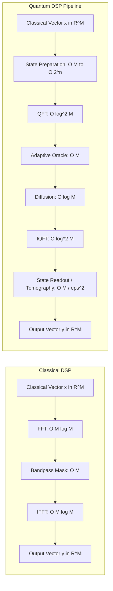

# SignalChain-Q: Asymptotic Complexity & Resource Analysis

**Document:** Mathematical & Algorithmic Complexity Evaluation  
**Focus:** Classical FFT vs. Quantum Fourier Transform (QFT) + Amplitude Amplification for Classical ECG Data  

---

## 1. Subroutine vs. End-to-End Complexity

A common misconception in applied quantum computing is that the $O(\log^2 M)$ gate complexity of the Quantum Fourier Transform (QFT) implies an exponential speedup over the classical Cooley-Tukey Fast Fourier Transform ($O(M \log M)$) for digital signal processing.

When applied to **classical input signals** (such as ECG time-series samples $x \in \mathbb{R}^M$), this comparison is incomplete because it ignores the input (state preparation) and output (measurement/reconstruction) stages of the pipeline.

---

## 2. Mathematical Breakdown by Stage

Let $M = 2^n$ be the segment length (number of samples), where $n$ is the number of qubits.

### A. State Preparation (Classical-to-Quantum Encoding)
To process classical samples $x = [x_0, x_1, \dots, x_{M-1}]^T$ on a quantum computer, the data must be embedded into a quantum state:
$$|\psi_x\rangle = \frac{1}{\|x\|_2} \sum_{i=0}^{M-1} x_i |i\rangle$$
- **Arbitrary Amplitude Encoding:** In the absence of a fault-tolerant Quantum Random Access Memory (QRAM), synthesizing an arbitrary normalized state $|\psi_x\rangle$ requires generic unitary decomposition (e.g., Möttönen or Shende state preparation).
- **Gate Complexity:** $\Theta(2^n) = \Theta(M)$ elementary single-qubit rotations and CNOT gates.
- **Circuit Depth:** $\Theta(2^n / n) = \Theta(M / \log M)$ or $\Theta(M)$ without all-to-all connectivity.
- **Conclusion:** The state preparation stage alone scales linearly with signal length, matching or exceeding the work of classical FFT before any quantum gates are executed.

### B. Quantum Fourier Transform (QFT)
Once $|\psi_x\rangle$ is encoded on $n$ qubits:
- **Gate Complexity:** $\frac{n(n-1)}{2}$ controlled-phase gates $+ n$ Hadamard gates $= \Theta(n^2) = \Theta(\log^2 M)$.
- **Circuit Depth:** $\Theta(n) = \Theta(\log M)$ with parallel execution.
- **Subroutine Assessment:** The QFT acts exponentially faster on the $n$-qubit state than classical FFT on an $M$-dimensional vector. However, this transformation occurs on probability amplitudes, which are not directly accessible.

### C. Spectral Filtering Oracle
The quantum adaptive filter marks frequency bins $k \in \mathcal{K}_{\text{pass}}$ corresponding to the QRS band ($f_{\text{low}} \le f_k \le f_{\text{high}}$) with a $\pi$-phase flip:
$$U_{\mathcal{K}} |k\rangle = (-1)^{[k \in \mathcal{K}_{\text{pass}}]} |k\rangle$$
- **Diagonal Unitary Synthesis ($O_1$):** A general diagonal operator with arbitrary phase assignments has circuit complexity $\Theta(2^n) = \Theta(M)$ CNOT gates.
- **Range / Comparator Oracle ($O_2$):** Decomposing the condition $k_{\text{low}} \le k \le k_{\text{high}}$ into multi-controlled phase gates requires $\Theta(|\mathcal{K}_{\text{pass}}| \cdot n)$ gates.

### D. Amplitude Amplification (Grover Diffusion)
The diffusion operator $D = 2|s\rangle\langle s| - I$ reflects the state about the equal-superposition or state-prepared reference state:
- For standard uniform diffusion: $\Theta(n) = \Theta(\log M)$ gates and depth $\Theta(n)$.
- For generalized Grover diffusion reflecting about the arbitrary input $|\psi_x\rangle$:
  $$D_{\psi} = 2|\psi_x\rangle\langle\psi_x| - I = U_{\text{prep}} (2|0\rangle\langle 0| - I) U_{\text{prep}}^\dagger$$
  This requires uncomputing the state preparation circuit, adding $\Theta(M)$ gates per iteration!

### E. Inverse QFT (IQFT)
Identical to QFT: $\Theta(n^2) = \Theta(\log^2 M)$ gates.

### F. Measurement & Signal Reconstruction (Quantum-to-Classical Readout)
To reconstruct the filtered classical signal $y \in \mathbb{R}^M$ for downstream diagnostic interpretation:
- On a **physical quantum processor**, individual measurements yield bitstrings with probability $P(i) = |\langle i | \psi_{\text{out}}\rangle|^2$.
- Estimating all $M$ amplitudes with precision $\epsilon$ requires quantum state tomography:
  $$\text{Sample Complexity} = \Omega\left(\frac{M}{\epsilon^2}\right) \text{ measurements}$$
- In classical simulation (Aer statevector), the amplitudes are extracted directly from the statevector memory in $\Theta(M)$ time.

---

## 3. Asymptotic Summary Table

| Stage | Classical DSP | Quantum Subroutine | End-to-End Quantum (NISQ) | Quantum Simulation |
| :--- | :--- | :--- | :--- | :--- |
| **Input Ingestion** | $O(1)$ memory pass | — | $O(M)$ amplitude prep | $O(M)$ vector norm |
| **Frequency Transform** | $O(M \log M)$ (FFT) | $O(\log^2 M)$ (QFT) | $O(\log^2 M)$ | $O(M \log M)$ matrix-vector |
| **Spectral Masking** | $O(M)$ multiply | $O(M)$ or $O(K \log M)$ | $O(M)$ CNOTs | $O(M)$ phase flip |
| **Amplification ($r$ iters)**| N/A | $r \cdot O(\log M)$ | $r \cdot [O(M) + O(\log M)]$ | $r \cdot O(M)$ |
| **Inverse Transform** | $O(M \log M)$ (IFFT) | $O(\log^2 M)$ (IQFT) | $O(\log^2 M)$ | $O(M \log M)$ |
| **Signal Reconstruction**| $O(1)$ direct array | — | $O(M / \epsilon^2)$ tomography | $O(M)$ statevector copy |
| **Total End-to-End Cost**| $\mathbf{O(M \log M)}$ | $\mathbf{O(\log^2 M)}$ *(isolated)*| $\mathbf{O(M / \epsilon^2)}$ | $\mathbf{O(M \log M)}$ |

---

## 4. Scientific Conclusions for Publication

1. **No Algorithmic Speedup on Classical ECG:**
   The claim of an exponential speedup ($O(\log^2 M)$ vs $O(M \log M)$) is valid **only if** the quantum state is generated by a prior quantum process (e.g. quantum sensor or quantum simulation) and the output is consumed by a quantum algorithm without full state tomography.
2. **State Preparation Bottleneck:**
   For classical biomedical data, the state preparation and measurement overhead dominates the execution runtime.
3. **Valid Scientific Justification:**
   The primary justification for investigating QFT-Grover DSP is **not** raw computational runtime on classical workstations, but understanding **unitary spectral transformation properties, quantum noise tolerance, and the algorithmic behavior of amplitude amplification on continuous biological signals** as a template for native quantum sensor inputs.
